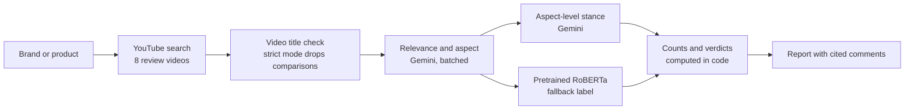

<div align="center">

# What do people really say about a product?

**Type any brand or product. Get a report built from real YouTube comments, where every claim cites a comment.**


</div>

<!--SCREENSHOTS-->

## What it does

Search for any product, for example `Mahindra Thar`, `Sony WH-1000XM5` or `Nike shoes`. The app collects comments from the top YouTube review videos, keeps only the ones about the product itself, sorts them into aspects (design, price, battery, comfort and so on), judges sentiment toward each aspect, and writes a report where every claim points to a numbered comment you can read.

- **Works for any product.** The aspect list is proposed from the comments themselves, so a laptop gets "keyboard" and "hinges" while a car gets "interior" and "performance".
- **Evidence you can check.** Quoted comments carry ids like `C12`. The report generator may only cite ids it was given, and any other id is stripped and logged.
- **Numbers come from code, not the LLM.** Mention counts, thin-evidence flags and strength or weakness verdicts are computed deterministically. The model only writes short summaries.
- **Measured, with the failures reported.** See [Measured results](#measured-results), including a fine-tuning experiment that did not beat the pretrained model.

## How it works



1. **Collect.** The top review videos for the search (8 videos, up to 100 top comments each, English only, links and very short comments removed).
2. **Check the videos.** A title check drops videos about a different product. Optional strict mode also drops videos that compare several products.
3. **Relevance and aspect.** A Gemini classifier keeps comments that give an opinion, experience or question about the product itself, and assigns each to one aspect.
4. **Aspect-level stance.** A second Gemini pass judges positive, negative or neutral toward that aspect, and flags comments that are really about the video, the presenter or another product.
5. **Report.** Verdict rule: an aspect is a strength or weakness only with at least 5 comments on that side and at least 2x as many as the other side, otherwise it is mixed. Fewer than 10 mentions is flagged as thin evidence.

The interface shows an at-a-glance card per aspect, a complaints-versus-praise view, suggestions (labeled as hypotheses) and an evidence tab that lists every cited comment.

## Measured results

> [!NOTE]
> All numbers come from small hand-labeled samples. Treat them as indications, not guarantees.

| Check | Result |
|---|---|
| Fine-tuned RoBERTa vs the pretrained model, TweetEval test set (about 12k tweets) | Macro-F1 0.707 vs 0.725. Difference -0.018, 95% CI [-0.024, -0.011]. Fine-tuning did not help, so the pretrained model is used. |
| The same comparison on hand-labeled YouTube comments | Nike (n=137): 0.598 vs 0.633, CI of the difference [-0.117, +0.040]. Thar (n=94): 0.634 vs 0.712, CI [-0.164, +0.002]. Neither interval excludes zero. Negative recall was lower for the fine-tuned model on all three sets. |
| Relevance filter on 161 hand-labeled Nike comments (deployed prompt) | Off-topic share among kept comments fell from 14.9% to 2.7%. It removed 21 of 24 off-topic comments but kept only 78% of on-target ones. An earlier, looser prompt reached 4.4% off-topic with 96% kept. All 161 comments had already passed an older keyword filter, so comments it wrongly dropped are not measured. |
| Aspect-level stance vs pretrained RoBERTa, 98 Nike rows | Macro-F1 0.724 vs 0.669. Negative recall 0.90 vs 0.64. Hand labels are comment-level while the stance is aspect-level, so this is a rough comparison. |

## Design decisions

- **Negative result kept in.** The fine-tune lost to the pretrained model, so the pretrained one ships. The comparison and its confidence intervals stay in this README.
- **Deterministic verdicts.** Early versions let the model decide which aspects were strengths or weaknesses and it misfiled them, so counts, flags and section placement moved into code.
- **Citation guard.** Every comment id in the generated text is checked against the quotes the model was given. Unknown ids are removed and listed under "Automatic checks".
- **Caches.** Raw comments, relevance labels, stance labels and finished reports are cached, so a repeated search is instant and the labels do not drift between runs (temperature 0).

## Limitations

> [!WARNING]
> The generated reports have not been audited claim by claim. Spot checks found cited comments about other models, about the video itself, or read too generously.

- A brand search can cover several models. Strict mode drops comparison videos but leaves fewer comments.
- Some off-topic or other-model comments still pass the filters, because the LLM judgments are imperfect.
- Relevance and stance were evaluated on one brand (Nike) with small samples. The fine-tuning comparison used Nike and Thar.
- Suggestions are hypotheses drawn from a small set of quoted comments, not validated advice.
- YouTube comments are not a random sample of customers.
- The app is not deployed publicly. The built-in limits (2 new analyses per session, 6 per hour, 25 per day) exist for a future public demo.

## Quick start

```bash
git clone https://github.com/Chukunju/social-media-sentiment-analysis.git
cd social-media-sentiment-analysis
python -m venv venv
venv\Scripts\activate          # macOS/Linux: source venv/bin/activate
pip install -r requirements.txt
```

Create a `.env` file in the project folder:

```
GEMINI_API_KEY=your-key-from-google-ai-studio
YOUTUBE_API_KEY=your-key-with-youtube-data-api-v3-enabled
```

Optional settings: `GEMINI_MODEL` (default `gemini-3.5-flash-lite`) and `GEMINI_WORKERS` (parallel Gemini requests, default 4).

```bash
streamlit run app.py
```

The first run downloads the RoBERTa model (about 500 MB). A new brand takes a few minutes, and results are cached. To produce a report in the terminal instead:

```bash
python src/report_check.py Mahindra Thar
```

## Project structure

```
app.py                  Streamlit interface, rate limits, caching of finished reports
src/
  collector.py          YouTube search and comment collection, language filter
  pipeline.py           Builds the labeled dataset: video check, relevance, stance, RoBERTa label
  classify.py           Gemini relevance and aspect classifier (batched, cached)
  stance.py             Gemini aspect-level stance (batched, cached)
  insights.py           Counts, verdicts and the cited report
  live.py               Runs a brand end to end and stores the result
  preprocess.py         Text normalization
  eval_*.py             Evaluation scripts behind the measured results
  compare_test.py       Fine-tuned vs pretrained comparison on TweetEval
reports/                Saved example reports
live_cache/             Saved results that open instantly in the app
```

## Roadmap

- [ ] Public deployment of the live app
- [ ] Audit a sample of cited comments by hand and publish the support rate
- [ ] Label a second brand to check whether the Nike numbers hold
- [ ] Per-comment model tagging, so a search for one model ignores comments about another

## License

MIT. See [LICENSE](LICENSE).